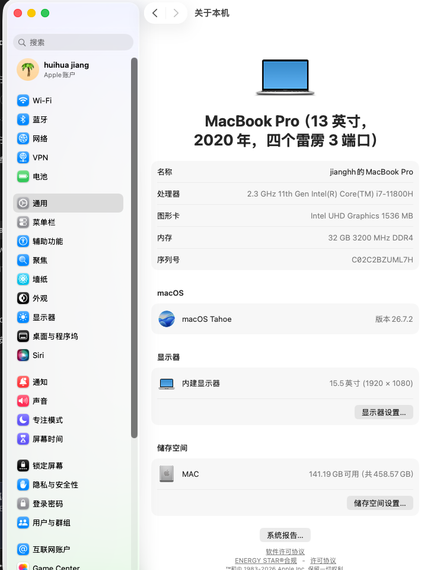
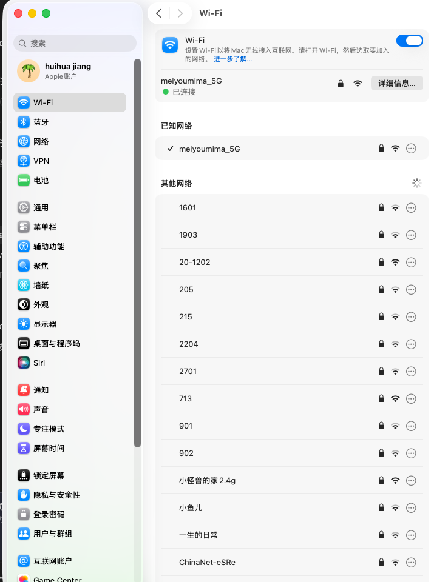
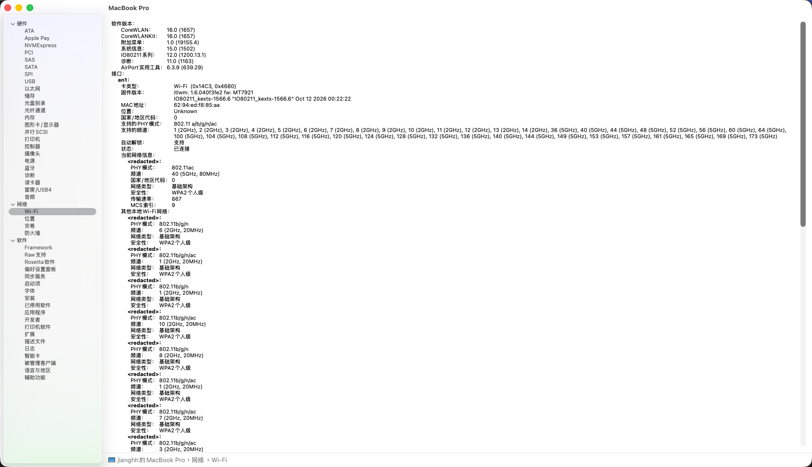

# MT7921 macOS 26 (Tahoe) Wi-Fi 修复补丁集（P1–P29，含前置 ALL-baseline-to-P19）

针对 [`lidiaoo/SimpleMtkWlan`](https://github.com/lidiaoo/SimpleMtkWlan) 的 MediaTek MT7921 (`14c3:7961`) 驱动修复集，
解决 macOS 26.7 (Tahoe) 上的一系列 Wi-Fi 缺陷：5G 网络扫不到/进不了列表、列表剧烈跳动、
连接全挂（僵尸关联）、PHY Mode 显示 None 等。
补丁链分两批：**P1–P19**（前置，join/状态机/密钥层，打包为 `ALL-baseline-to-P19` 一个补丁）
与 **P20–P29**（扫描/发布/会话层，10 个独立补丁），两批缺一不可，按序全部应用。

**测试环境**：Acer Nitro 5（i7-11800H）· MT7921 · macOS Tahoe 26.7.2 · OpenCore







> 系统信息 > Wi-Fi 详情：PHY Mode 正确显示 802.11ac（当前连接，ch40/80MHz），
> 其他本地网络逐条显示 802.11a/n/ac（P25 补全 beacon IE 前这里全是 None），
> 固件 `IO80211Texts_1566.6`、支持信道 1~165 全列。

---

## 修复内容

### 0. 前置修复（`ALL-baseline-to-P19`，即 P1–P19，2026-11-06 ~ 11-09）

在 P20 之前，这批补丁已经把 WCL join/状态机层面的一批致命问题修掉——
没有它们，P20–P29 的扫描/发布修复根本无从谈起。按主题归纳：

**扫描通道（WCL.cpp）**
- **P7 扫描窗口卡死**：信道 walk 被 join 打断后 `SCAN_DONE` 事件可能永远不来，
  `scanPending` 永久锁存，之后所有扫描请求都回 `kIOReturnBusy`——
  表现为「Wi-Fi 菜单空了，只能关开 Wi-Fi 电源」。修复：窗口关闭时清理锁存，
  扫描结束把节点树缓存一次性补发给 IO80211（`publishWCLCachedResults`，
  IO80211 只认 postMessage，不读驱动的节点树）
- **P15 join 重放**：join 在扫描进行中到达时不再被拒（`kIOReturnBusy` 会让
  airportd 直接丢弃请求），记为 deferred，扫描完自动重放
- **P1–P4 诊断**：WCL 扫描请求原始信道表/flags dump（`DIAG [scan-5g]`），
  用于实锤 decodeScan 三条猜测规则把 5G 信道 bitmap 全部丢掉的事实

**关联状态机（MtkMwx.cpp / ieee80211_input.c）**
- **P5/P6 发送路径**：管理帧（AUTH/ASSOC/DEAUTH）走 `ic_mgtq`，旧代码在数据队列
  oactive 时提前 return，管理帧被无限期阻塞；net80211 已在状态切换时发过
  ASSOC_REQ，驱动不再重复发
- **P8/P10 关联响应**：关联成功后不再重复发 ASSOC_REQ（`ic_state` 滞后竞态）；
  一次 ASSOC_REQ 只接受一份 ASSOC_RESP，过期 AID 不跨关联残留
- **P9 重发时机**：只在 AUTH→S_ASSOC 进入时重发；RUN→ASSOC 意味着 AP 已拆链，
  此时发 ASSOC_REQ 只会换来 class 3 frame deauth
- **P12 死机检测**：AUTH/ASSOC 停滞且 `ic_mgt_timer==0`（没有任何东西会再驱动
  状态机）连续 6 个轮询周期 → 判定卡死，从 S_INIT 重来。实测状态机曾在
  state=2 停了 29 轮，所有扫描请求被 "authing state=2" 拒绝
- **P14 RUN 风暴守卫**：60 秒窗口内 5 次进入 RUN = 握手永远完不成，重置；
  已有 PMK 时不再重新认证

**密钥与节点（ieee80211_node.c / var.h）**
- **P13 空 PSK 不覆盖**：WCL join 把 PMK 直接写进 `ic_psk`，而 ESS 表项里的
  `ess->psk` 是 32 个零字节——切网络时 `set_ess` 曾把真密钥覆盖成全零，
  4-way 用零密钥跑，AP 连拒 msg 2/4 九次、永远连不上。实测日志
  `key check b0`（对密码）→ 600ms 后 `key check 80`（零字节哈希）
- **P17 空壳节点**：`leaveWCLNetwork()` 清空过的节点仍挂在 `ic_tree` 里
  （protos/akms/ciphers 全 0），join 它会把空 MAC 拷进 `ic_bss`，AUTH 重试发往
  `ff:ff:ff:ff:ff:ff` 六轮（实测浪费 20.9 秒）。修复：要求节点信息完整才可 join
- **P18/P19 deauth 语义守卫**：区分「我们自己抹的 PSK」（join 失败/leave，正常）
  与「真故障」；S_AUTH 进入时驱动的 pre-auth deauth 会引来部分 AP 的 deauth
  回声，加 `ic_wcl_preauth_deauth` 标记防止 net80211 把真 deauth 当回声吞掉；
  全部走 `AIRPORT_WCL` 宏守卫，SimpleMtkWlan 产品编译不受影响

### 1. 全信道扫描（P20+P21+P22）
- 扫描窗口与 dwell 时间统一（全扫 80ms/信道），去掉 `SPLIT_SCAN` 分割扫描
- 关联状态下每信道扫描耗时 **230ms → 138ms**
- 实测 **26/26 轮全部覆盖 41 信道**，5G 信道不再漏扫

### 2. 节点表扩容（P24）
- net80211 节点缓存 `IEEE80211_CACHE_SIZE` 200 → 512
- 原 因：环境 AP 多时 200 上限被 2.4G 节点占满，`ieee80211_find_rxnode` 退化到
  `ic_bss`，**5G 管理帧全被吸收**——这是「5G 网络永远进不了列表」的根因
- 实测：扩容后节点树 2g=84 / 5g=128，5G 首次入树

### 3. Beacon IE 完整合成（P25 + P29）
- 发布给 airportd 的扫描结果重建完整 IE 链（Rates / HT Cap / HT Op / VHT Cap /
  VHT Op / RSN），macOS 对 5GHz 网络硬性要求 HT 以上，缺 IE 的条目会被判非法丢弃
- 实测：**PHY Mode 从 None 恢复为 802.11a/n/ac/ax**，airportd Failed=0
- P29：仅 2.4G 节点携带 DS Params（与真实 beacon 一致，避免污染 airportd 信道记录）

### 4. 列表发布策略（P23+P26+P27）
- 扫描期只收集不发布，扫描结束**一次性批量发布**，消除列表每轮抖动
  （实测每轮单条 `WCL scan finish completed=1`）
- 发布上限 40 条（RSSI 降序，已连接 BSS 保底保留）；实时逐条发布通道关闭
  （airportd 只合并不淘汰，实时流会越攒越全）
- 需要 40 条以上时加 boot-arg **`-mtk-allwifi`** 解除上限并恢复实时流

### 5. 僵尸关联修复（P28）★ 最关键
- 原因：WCL join 成功后 `ic_wcl_join_requested` 会话标志永久残留，任何电源循环 /
  掉线后 net80211 栈会**绕过 airportd 从节点缓存自动重连**，airportd 完全不知情
  （UI 显示断开、ping 却通），后续所有 join 的 live scan 被卡死拒绝
- 修复：join 成功也结束会话；`end_scan` 无活跃 join 请求不自行选网络——重连一律
  由 airportd 下发
- 实测：join 成功率 **0/10 → 9/9**（含 7 轮电源循环压力测试），面板「忽略此网络」
  流程干净回扫、无复活

---

## 验证数据（最终版，macOS 26.7.2 实测）

| 项目 | 结果 |
|---|---|
| 全信道扫描覆盖 | 41/41 信道，无漏扫 |
| 关联态扫描速度 | 138 ms/信道 |
| 每轮发布 | 单次完成，40 条（`-mtk-allwifi` 全量） |
| join 成功率 | 9/9（电源循环压力测试 7/7） |
| 4-way 握手 | 邻居中继器偶发拒绝 1~2 次后放行（AP 侧问题，驱动重试兜住） |
| 互联网连通 | 关联后 ping 网关/公网 0% 丢包，链路 MCS 9 / 867 Mbps |

> 已知限制：系统设置 Wi-Fi 面板的列表内容由 airportd 按请求 bitmap 过滤展示，
> 偶尔显示 2.4G 子集、偶尔全量属于 macOS 自身行为；join 走驱动节点缓存，
> **不受面板显示影响**（实测面板 5G=0 时 join 仍 2.2 秒成功）。

---

## 使用方法

### 应用补丁

```bash
git clone https://github.com/lidiaoo/SimpleMtkWlan && cd SimpleMtkWlan
git checkout c28b1d8                              # 基线 commit（2026-11-06）
git apply patches/lidiaoo-local-ALL-baseline-to-P19.patch
for n in P20-scan-window P21-all-channel-scan P22-full-sweep-always \
         P23-rssi-order-single-burst P24-node-cap-512 P25-beacon-ies \
         P26-single-completion P27-live-hold P28-zombie-join-session \
         P29-dsparams-5g; do
  git apply "patches/lidiaoo-local-$n.patch"
done
```

### 编译

```bash
./build-macos.sh Release AirportMtkWlan
# 产物: build/Release/tahoe/AirportMtkWlan.kext
```

### 部署

把 `AirportMtkWlan.kext` 放入 EFI 的 `OC/Kexts/`（config.plist 中该 kext 需
`Enabled=true`），重启生效。可选 boot-arg：

- `-mtk-allwifi`：解除 40 条发布上限，显示扫描到的全部网络

---

## 补丁校验值（sha256 前 16 位）

| 补丁 | 行数 | sha256 |
|---|---|---|
| `ALL-baseline-to-P19`（c28b1d8→P19 全量） | 1,299 | `a483aa8f1e95a405` |
| `P20-scan-window` | 107 | `c2360557fc36586f` |
| `P21-all-channel-scan` | 93 | `6d9abafb204c2572` |
| `P22-full-sweep-always` | 111 | `beebf0b5f1c73b6d` |
| `P23-rssi-order-single-burst` | 95 | `e091e0837c003228` |
| `P24-node-cap-512` | 93 | `cb6203b5e636b5ef` |
| `P25-beacon-ies` | 167 | `584094ff6f6d6919` |
| `P26-single-completion` | 142 | `eb5e272fa5261a93` |
| `P27-live-hold` | 67 | `1ab2209deb52a50a` |
| `P28-zombie-join-session` | 51 | `fdb809eeb3df3721` |
| `P29-dsparams-5g` | 60 | `459393d5d7a543fc` |

全链已验证：`c28b1d8` + 11 个补丁 = 与实测源码树逐字节一致；编译产物
`AirportMtkWlan.kext`（2,697,704 B）sha256 `e53b43745507a71a…`。

## 已知问题

- 邻居中继器 44:df:65:cd:00:00 会反复拒绝 4-way msg 2/4（重试后通过），偶发
  长时间不响应 msg 1/4——AP 侧问题
- `networksetup -getairportnetwork` 在 macOS 26 会误报未关联；判断关联状态请用
  `system_profiler SPAirPortDataType` 或 `ipconfig getsummary`
